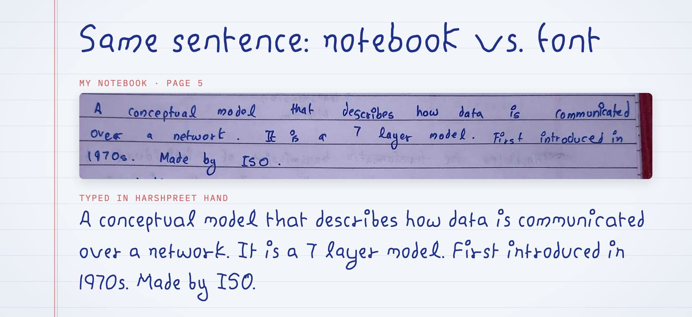
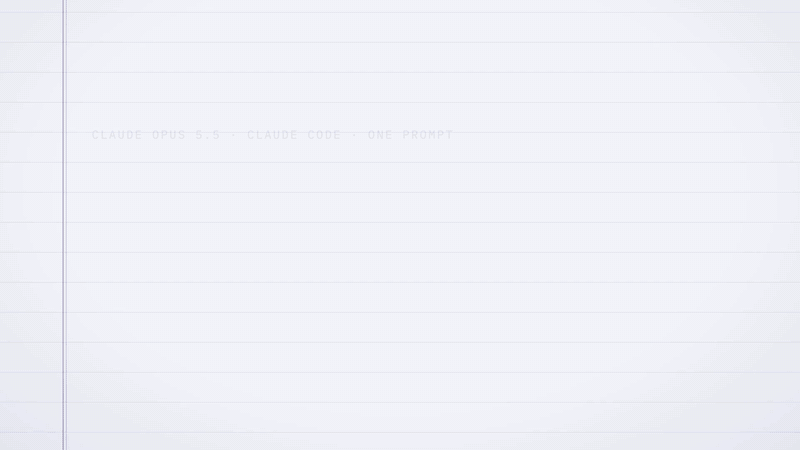
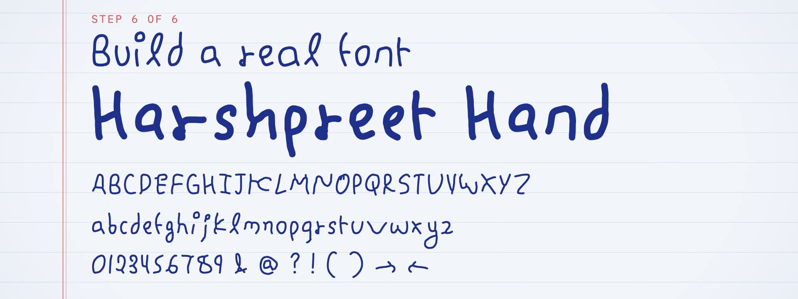
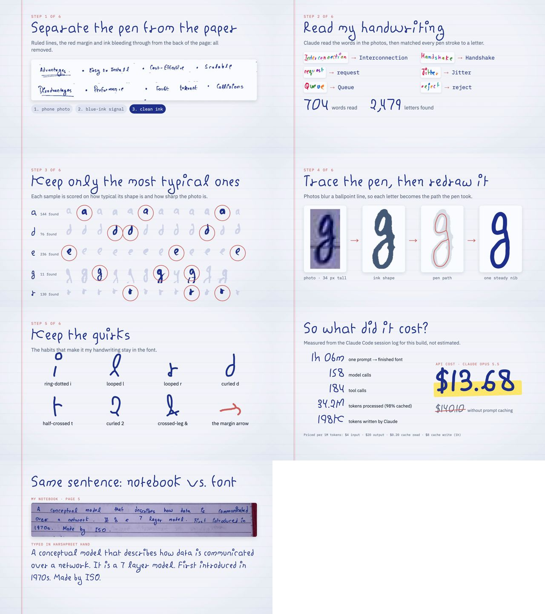
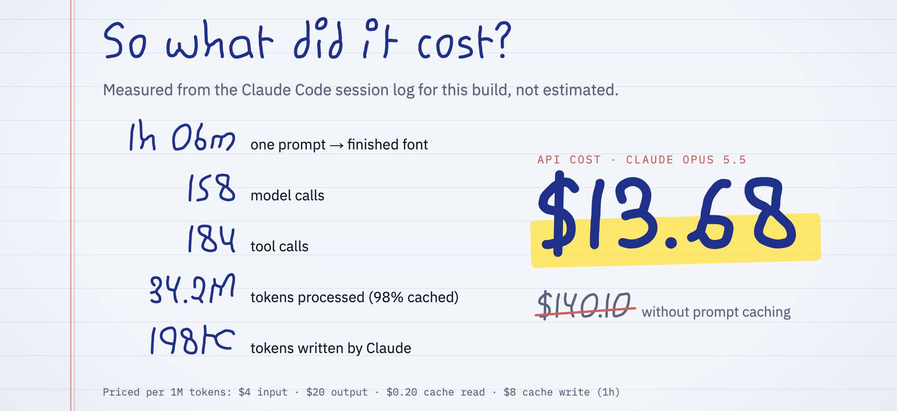

<h1 align="center">Harshpreet Hand</h1>

<p align="center">
  <b>I gave Claude Code 120 pages of my handwritten college notes.<br>
  It gave me back my handwriting, as a real font.</b><br>
  One prompt · 1 h 06 min · $13.68 in API calls
</p>

<p align="center">
  <a href="https://harshpreet931.github.io/harshpreet-hand/"><b>Type in it →</b></a> ·
  <a href="https://github.com/harshpreet931/harshpreet-hand/releases/latest/download/harshpreet-hand.zip">Download</a> ·
  <a href="#use-it-in-one-line">Use it in one line</a> ·
  <a href="#how-it-was-made">How it was made</a> ·
  <a href="#make-one-from-your-own-handwriting">Make your own</a>
</p>

<p align="center">
  <a href="OFL.txt"></a>
  <a href="LICENSE"></a>
  
  
</p>



Every letter comes from the notes: it was found in the page photos, then redrawn
along the pen's path with one steady ballpoint nib. Each letter has 2–3 real
variants from different pages that rotate as you type, so doubled letters never
look stamped.

## Watch it get built

[](https://github.com/harshpreet931/harshpreet-hand/releases/latest/download/harshpreet-hand-making-of.mp4)

<sub>2x speed. [Full 65-second video (MP4)](https://github.com/harshpreet931/harshpreet-hand/releases/latest/download/harshpreet-hand-making-of.mp4). Every frame is real pipeline output, made with Remotion in [`video/`](video/).</sub>

## Use it in one line

```html
<link rel="stylesheet" href="https://cdn.jsdelivr.net/gh/harshpreet931/harshpreet-hand@v1.0.0/dist/harshpreet-hand.css">
<style>
  body { font-family: "Harshpreet Hand", cursive; line-height: 1.6; }
</style>
```

Or install it on your computer for Figma, Keynote, Word and the rest: grab
`HarshpreetHand-Regular.ttf` and `-Bold.ttf` from the
[latest release](https://github.com/harshpreet931/harshpreet-hand/releases/latest).



### What's in `dist/`

| File | Use |
| --- | --- |
| `HarshpreetHand-Regular.woff2` / `-Bold.woff2` | Web (use these) |
| `HarshpreetHand-Regular.woff` / `-Bold.woff` | Web fallback for very old browsers |
| `HarshpreetHand-Regular.ttf` / `-Bold.ttf` | Install on your computer (Figma, Keynote, …) |
| `harshpreet-hand.css` | `@font-face` rules + a ready `data-theme="handwritten"` theme |
| `specimen.html` | Specimen and type tester ([live version](https://harshpreet931.github.io/harshpreet-hand/)) |
| `notes-sample.jpg` | Crop of the original notes, used by the specimen |

### Add it to a site as a theme

1. Copy the `.woff2` (and optionally `.woff`) files into the site, e.g. `public/fonts/`.
2. Copy `harshpreet-hand.css` next to them (or paste its rules into your global CSS) and fix the `url()` paths if needed.
3. Turn the theme on: `document.documentElement.dataset.theme = "handwritten"`.

```css
[data-theme="handwritten"] {
  font-family: "Harshpreet Hand", "Segoe Print", cursive;
  font-size: 1.15em;   /* x-height is 0.44 em, a bit smaller than UI fonts */
  line-height: 1.6;    /* room for the long g / y loops */
  font-feature-settings: "calt" 1, "kern" 1;
}
```

Tips:
- Keep `line-height` at 1.5 or more. The g and y loops go deep, just like in the notes.
- Use it for headings and prose. Keep code, tables and dense UI in your normal fonts.
  The theme CSS already does this for `code`/`pre`.
- Optional classes in the CSS: `.notebook` adds ruled paper with a red margin line,
  `.notebook-spacing` adds the wide word gaps from the notes, and `.plain-r`
  switches to the plain r.

## Features

- **`calt` (on by default):** every letter and most figures have 2–3 real variants from different
  pages. The font rotates through them as you type, so `hello` → h, e², l³, l¹, o² and
  doubled letters never look stamped. Each variant also sits slightly higher or
  lower than the others, like real handwriting.
- **`ss01`:** a plain r without the little loop at its foot.
- **`kern`:** kerning computed from the letter outlines (e.g. `To`, `Ty`, `r.`).
- **Coverage:** A–Z, a–z, 0–9, ASCII punctuation, curly quotes, dashes, `… • · ° × ÷`,
  arrows `→ ← ↑ ↓` (taken from the arrows in the notes' margins), and Western European accents.

## Quirks it keeps

Ring-dotted **i**/**j** · looped **l** · **r** with a small loop at its foot · curled
**d** · **t** crossed on the right only · curl-footed **2** · the crossed-leg
**&** · hook-headed **→** · the rounded **W** with a tall first stroke · the barred **I**.

## How it was made



The source is [`CN_CompleteNotes_FullSyllabus.pdf`](CN_CompleteNotes_FullSyllabus.pdf):
120 phone photos of my *Computer Networks* notes, covering the full syllabus. (If
you're studying CN, they're yours to read too.)

| Step | Script (`pipeline/`) | What it does |
| --- | --- | --- |
| 1 | `render_pages.py` | Renders the PDF pages to images |
| 2 | `ink.py`, `segment.py`, `segment_all.py` | Separates the blue ink from the paper, ruled lines, red margin and back-page bleed-through, then splits pages into words and letter groups |
| 3 | `labels/*.txt` | Transcriptions of 704 words by word id (`12: packets`, `{0:W}` to assign one group directly, `\?` for a literal ?) |
| 4 | `harvest.py` | Matches transcriptions to letter groups. Where letters touch, a dynamic-programming alignment recovers the single letters. Output: 2,479 samples normalized to baseline and x-height |
| 5 | `select_samples.py` | Ranks each letter's samples by typicality and photo sharpness |
| 6 | `candidates.py`, `strokes.py` | Skeleton → pen centerline graph → smoothing (strokes joined through crossings) |
| 7 | `design/picks.json`, `design.py`, `construct.py` | The chosen variants, height normalization, and letters built from parts of the hand (G, J, X, most punctuation, accents, ← ↑ ↓) |
| 8 | `build_font.py` | Round-nib rendering → potrace → TrueType, metrics, `calt`/`ss01`/`kern`, WOFF/WOFF2 |
| – | `verify.py`, `preview.py`, `grid.py`, `make_specimen.py` | Checks (HarfBuzz + FreeType) and the specimen page |

### What it cost



Measured, not estimated: [`pipeline/session_stats.py`](pipeline/session_stats.py)
totals the `usage` blocks in the Claude Code session log and prices them at
Claude Opus 5.5 API rates. Prompt caching is what kept it at $13.68 instead of $140.

## Rebuild it

```bash
brew install potrace                      # or: apt install potrace
python3 -m pip install -r requirements.txt
pipeline/run_all.sh                       # ≈10 min; intermediates go to work/
pipeline/run_all.sh font                  # only the font, after tweaking spacing or weight
```

Things you can tweak in `pipeline/build_font.py`:
- `WEIGHTS`: nib size per weight (`pen` is a fraction of the x-height; Regular 0.13, Bold 0.20). Add a `Light` entry for a third weight.
- `SB` / `SPACE`: letter and word spacing.
- `FAMILY` / `PS_FAMILY`: the font's name.

To swap a variant, change its source `[page, word id, group]` in `design/picks.json`
(`python3 candidates.py abc out.png` shows the numbered candidates), then run `run_all.sh`.

## Make one from your own handwriting

The pipeline is tuned to these notes (blue ballpoint on ruled paper, shot on a
phone), but every step is a plain script and every choice specific to my hand
lives in a file you can edit:

1. Put photos of your pages into one PDF. Blue ink on ruled paper works as is;
   for other inks, adjust the colour model in `pipeline/ink.py`.
2. `cd pipeline && python3 render_pages.py ~/my-notes.pdf && python3 segment_all.py`
   splits every page into words. `python3 segment.py 4 13 38` then draws numbered
   contact sheets for those pages (`work/seg/sheet_p004_0.png`, …).
3. Replace `labels/*.txt` with your own transcriptions (`labels/p004.txt` for page 4),
   one `id: word` line per word. About 700 words gave me 2–3 good variants of most letters.
4. `python3 harvest.py && python3 select_samples.py`, then choose your variants in
   `design/picks.json` (`python3 candidates.py abc out.png` shows the candidates).
5. Set `FAMILY` / `PS_FAMILY` and the name strings in `build_font.py`, then
   `python3 design.py && ./run_all.sh font`.

`construct.py` builds G, J, X and most punctuation from parts of my letters, so
check those against your hand. The shortcut is the way this one was made: open
the repo in [Claude Code](https://claude.com/claude-code) next to your PDF and
ask it to adapt the pipeline to your handwriting.

## Limitations

- A few capitals (V, W, Z) had only one clean sample in the notes, so they have one variant.
- G, J, X and most punctuation were built from other parts of the hand rather than traced directly.
- No hinting: it renders well at normal web sizes on modern browsers, but it isn't tuned for tiny text on old Windows ClearType.

## License

- **Fonts** (`dist/*.ttf`, `*.woff`, `*.woff2`) and glyph data (`design/`):
  [SIL Open Font License 1.1](OFL.txt). Use, embed and ship them in personal
  or commercial work; you can't sell the font on its own.
- **Code** (`pipeline/`, `video/`): [MIT](LICENSE).
- **Notes and images** (`CN_CompleteNotes_FullSyllabus.pdf`, `assets/`):
  [CC BY 4.0](https://creativecommons.org/licenses/by/4.0/).

If you make something with it, or a font from your own handwriting, I'd love to
see it. Open an issue or tag me.
